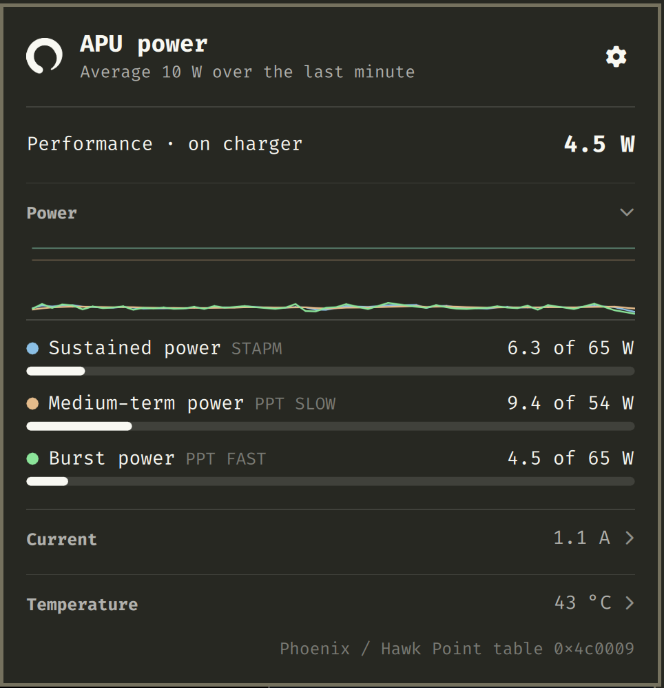

# amdpower for Omarchy

An Omarchy plugin that shows APU/CPU power usage and power limits on AMD Ryzen platforms.



It reads the SMU power table straight from the `ryzen_smu` kernel module. It never changes any limits, and it doesn't need root or `ryzenadj`.

# Quick start
## Install SMU kernel module
```bash
yay -S ryzen_smu-dkms-git
sudo modprobe ryzen_smu
# Load at every boot
echo ryzen_smu | sudo tee /etc/modules-load.d/ryzen_smu.conf
```

## Install the plugin
```bash
omarchy plugin add https://github.com/abagonhishead/omarchy-amdpower --enable
```
# Supported platforms
I've only tested this on a Phoenix APU (power table version `0x4c0009`.)

Technically, it should also support Raven, Picasso, Renoir, Cezanne, Rembrandt, Van Gogh, Dragon Range, Strix Point, Strix Halo, Krackan Point, and other Phoenix & Hawk Point revisions, but they are untested.

If you use this and it works, please can you raise an issue or a PR to [mark your power table as supported](https://github.com/abagonhishead/omarchy-amdpower/blob/a89c110503ea1faba32c7efc65104a04b6c68f51/Model.js#L125).

Likewise, if it doesn't work, please raise an issue with detail about what isn't working, or raise a PR to fix it. Feel free to use an LLM to help you, there are no restrictions on AI contribution to this repository.

# Settings
The settings cog provides access to a few basic settings:
- Show/hide the power reading in the tray, and adjust its font size
- Show/hide the bars
- Show/hide the 60s rolling graphs

# Credits

The power table layouts come from [RyzenAdj](https://github.com/FlyGoat/RyzenAdj).

# Licence

MIT. See [LICENSE](LICENSE).
