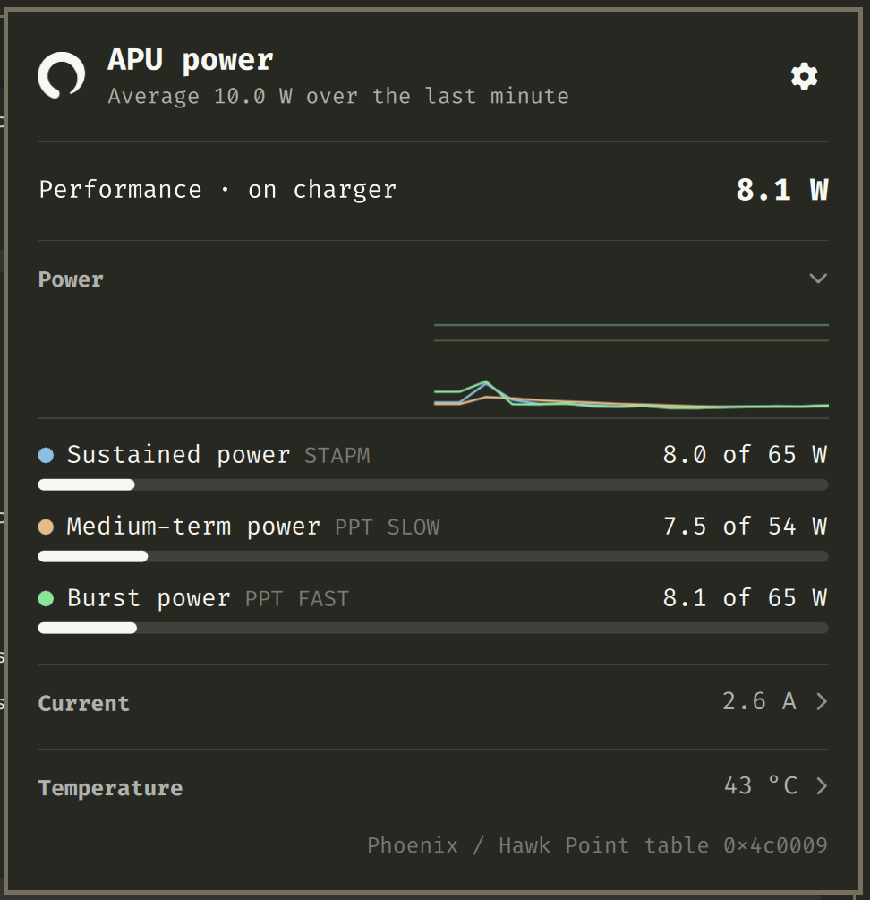

# AMD power for Omarchy

A read-only Omarchy bar widget for AMD Ryzen power limits. It shows live power next to the tray icon. Click it for every power, current and temperature limit with its live reading, a graph of the last minute, and a plain-English explanation on hover.



It reads the SMU power table straight from the `ryzen_smu` kernel module. It never changes any limits, and it doesn't need root or `ryzenadj`.

## Requirements

The `ryzen_smu` kernel module. Install it and load it:

```bash
yay -S ryzen_smu-dkms-git
sudo modprobe ryzen_smu
```

To load it at every boot:

```bash
echo ryzen_smu | sudo tee /etc/modules-load.d/ryzen_smu.conf
```

DKMS rebuilds the module whenever the kernel updates.

## Install

```bash
omarchy plugin add https://github.com/abagonhishead/omarchy-amdpower --enable
```

## Supported chips

Only **Phoenix** (Ryzen 7040 mobile, power table version `0x4C0009`) has been tested.

Layouts for the other table versions RyzenAdj knows were ported from its source and are untested. They cover Raven, Picasso, Renoir, Cezanne, Rembrandt, Van Gogh, other Phoenix and Hawk Point revisions, Dragon Range, Strix Point, Strix Halo and Krackan Point. On those chips the popup's footer marks the layout as untested. Chips whose table version isn't known show a "not supported yet" message rather than guessing.

If your readings look wrong, or your chip isn't supported, please [open an issue](https://github.com/abagonhishead/omarchy-amdpower/issues) with your CPU model, the table version from the popup's footer and the output of `sudo ryzenadj --info`. Or raise a PR: the layouts are in `Model.js`.

## Settings

Click the cog in the popup to:

- show or hide the power reading next to the tray icon, and change its text size
- show or hide the limit gauges
- choose which graphs to show, and whether they draw each reading's limit

Click a section's heading to collapse it. A collapsed section still shows its headline figure.

## Credits

The power table layouts come from [RyzenAdj](https://github.com/FlyGoat/RyzenAdj).

## Licence

MIT. See [LICENSE](LICENSE).
